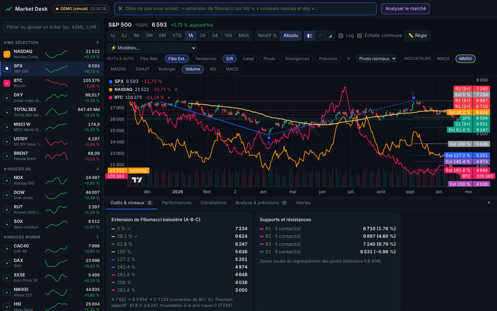

# Market Desk — tableau de bord marchés en direct

Application web locale pour suivre en direct les marchés, superposer autant d'actifs que voulu, tracer automatiquement les outils d'analyse technique (Fibonacci, tendances, supports/résistances…) et obtenir une analyse du marché avec des prévisions.



## Lancer l'application

Prérequis : **Node.js 20 ou plus récent** (https://nodejs.org).

- **Windows** : double-cliquez sur `lancer.bat`
- **macOS / Linux** : `./lancer.sh`

ou, en ligne de commande :

```bash
npm install
npm run build
npm start            # → http://localhost:8787
```

Pour développer : `npm run dev` (interface sur http://localhost:5173, rechargement automatique).
Sans connexion internet : `npm run start:demo` (données simulées, clairement signalées « DÉMO »).

### En cas de problème au lancement

- « 'tsc' / 'vite' / 'tsx' n'est pas reconnu » : les dépendances ne sont pas (ou mal) installées. Supprimez le dossier `node_modules`, puis relancez `lancer.bat` (ou `npm install --include=dev`).
- Le lanceur vérifie la version de Node.js (20 minimum) et affiche la cause de l'erreur au lieu de se fermer.
- Le port 8787 est déjà pris : définissez `PORT=8788` dans le fichier `.env`.

### Activer l'analyse par l'IA (optionnel)

Copiez `.env.example` en `.env` et renseignez votre clé API Anthropic :

```
ANTHROPIC_API_KEY=sk-ant-...
```

Sans clé, l'analyse locale (technique et statistique) reste entièrement disponible.

## Actifs suivis

| Demandé | Source utilisée |
|---|---|
| Nasdaq | Nasdaq Composite `^IXIC` (+ Nasdaq 100 `^NDX`) |
| S&P 500 | `^GSPC` |
| BTC | `BTC-USD` + flux temps réel Binance |
| DXY | `DX-Y.NYB` |
| TOTAL3ES | Indice reconstruit (voir plus bas) |
| MSCI World | ETF iShares MSCI World `URTH` (l'indice lui-même n'est pas diffusé gratuitement) |
| 10Y1! | Taux US 10 ans `^TNX` (en %) |
| Brent | Future Brent `BZ=F` |

**Ajoutés parce qu'ils comptent pour lire le marché** : Nasdaq 100, Dow Jones, Russell 2000 (small caps), semi-conducteurs (SOX), CAC 40, DAX, Euro Stoxx 50, Nikkei, Hang Seng, Ethereum, Solana, taux US 3 mois / 5 ans / 30 ans (courbe des taux), VIX, or, argent, WTI, cuivre, gaz naturel, EUR/USD, USD/JPY et les méga-caps (Apple, Microsoft, Nvidia, Amazon, Alphabet, Meta, Tesla).

N'importe quel autre ticker Yahoo Finance (ASML, MC.PA, ^VIX…) s'ajoute depuis la barre de recherche de la liste.

**TOTAL3ES** : aucun fournisseur gratuit ne publie son historique. L'application le reconstruit à partir des 16 principaux altcoins (hors BTC, ETH et stablecoins) — prix Yahoo × offre en circulation CoinGecko — puis recale le niveau sur la capitalisation réelle calculée depuis CoinGecko. Les variations sont fiables ; le niveau absolu est une très bonne approximation.

## Fonctionnalités

- **Cotations en direct** : rafraîchies toutes les 15 s, crypto à la seconde (Binance). Mini-graphiques intrajournaliers dans la liste.
- **Superposition illimitée** : cochez « + » à côté de n'importe quel actif.
  - **Relatif %** : toutes les courbes partent de 0 % au début de la période. Le bouton **Rebaser** permet de choisir une autre date de référence en cliquant sur le graphique.
  - **Absolu** : prix réels ; chaque actif garde sa propre échelle (ou « Échelle commune »), échelle logarithmique disponible.
- **Variations sur différentes périodes** : onglet *Performances* (1J, 1S, 1M, 3M, 6M, YTD, 1A, 3A, 5A, période personnalisée, écart au plus haut annuel), tri par colonne, filtre « hausse/baisse ≥ X % sur la période P ». Outil **Règle** pour mesurer la variation entre deux points du graphique.
- **Outils graphiques automatiques** (placés tout seuls, recalculés à chaque changement d'actif ou de période) :
  - **Extension de Fibonacci** : détecte le dernier schéma A-B-C valide (impulsion, correction de 20 à 100 %, C non cassé) et projette 38,2 / 61,8 / 100 / 127,2 / 141,4 / 161,8 / 200 / 261,8 %, avec le prochain objectif et le niveau d'invalidation.
  - **Retracement de Fibonacci** sur la dernière impulsion majeure.
  - **Lignes de tendance** (support et résistance obliques non cassés, signal de cassure).
  - **Supports / résistances** (zones touchées plusieurs fois).
  - **Canal de régression** (±1σ, ±2σ, z-score), **points pivots**, **divergences RSI**.
  - **Prévision** : cône Monte-Carlo (médiane, intervalles 50 % et 90 %, probabilité de hausse).
  - Sensibilité de détection des pivots réglable (fins / normaux / majeurs).
- **Indicateurs** : MM20/50/200, EMA21, Bollinger, volume, RSI et MACD (panneaux dédiés).
- **Modèles** (⚡) : appliquent en un clic un ensemble d'outils + indicateurs (Swing, Objectifs, Tendance, Momentum, Comparaison) ; vous pouvez enregistrer les vôtres.
- **Barre de commandes** (touche `/`) : dites simplement ce que vous voulez, par exemple
  - « extension de fibonacci sur btc en 1 an »
  - « compare nasdaq, sp500 et dxy en relatif sur 6 mois »
  - « supports et résistances + mm200 sur le brent »
  - « enlève les supports », « tout effacer »
  - « alerte si btc passe sous 95000 », « alerte si le nasdaq baisse de 5 % sur 1 semaine »
  - « analyse le marché avec l'IA, focus btc et us10y »
- **Alertes** : seuil de prix ou variation en % sur une période, avec notification du navigateur et son.
- **Corrélations** : matrice des corrélations des rendements journaliers (30 à 365 jours).
- **Analyse & prévisions** :
  - *Analyse instantanée* (sans IA) : régime de marché risk-on / risk-off (S&P 500, tech, VIX, dollar, taux 10 ans, BTC, altcoins, Brent, ratio cuivre/or, small caps, courbe des taux), tableau de bord, prévisions à ~1 mois (biais, probabilité de hausse, fourchette 90 %, support/résistance) et signaux détectés automatiquement (golden/death cross, MM200, plus hauts/bas 52 semaines, RSI extrêmes, mouvements anormaux).
  - *Analyse IA (Claude)* : lecture rédigée du marché à partir de tous ces chiffres, en option avec l'actualité récente (recherche web), scénarios et objectifs, puis questions de suivi.

Tous les réglages (actifs ajoutés, graphique, modèles, alertes) sont mémorisés dans le navigateur.

## Limites à connaître

- Les données proviennent de Yahoo Finance (gratuit, non officiel) : certains marchés sont légèrement différés (notamment les futures, ~10 min). Les cryptos sont en temps réel via Binance.
- Les prévisions sont des estimations statistiques et techniques, pas des certitudes. **Rien dans cette application ne constitue un conseil en investissement.**

## Structure

```
server/   API Node (Express) : Yahoo Finance, TOTAL3ES, cache, mode démo, analyse Claude (streaming)
shared/   catalogue des actifs et types communs
src/      interface React + lightweight-charts
  lib/    indicateurs, pivots ZigZag, outils automatiques, statistiques, analyse, commandes
tests/    tests (npm test)
```
